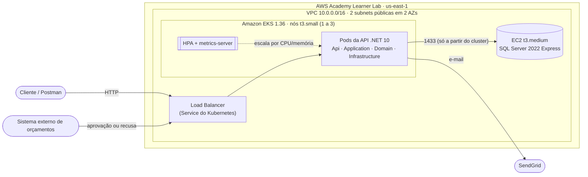
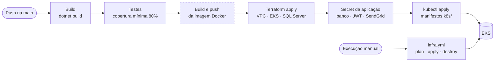

# Auto-repair

Sistema projetado para a gestão da oficina mecânica Auto Repair, com o objetivo de otimizar o fluxo
operacional, resolver problemas de priorização de atendimentos, controlar estoques/insumos e gerenciar
orçamentos e Ordens de Serviço (OS). Projeto do Tech Challenge da FIAP POSTECH SOAT.

## Escopo do sistema

O projeto visa solucionar os principais gargalos operacionais, por meio de funcionalidades que irão
apoiar nos seguintes tópicos:

- **Priorização de Atendimentos:** Organização e fila de veículos com base na capacidade produtiva;
- **Gestão de Ordens de Serviço (OS):** Acompanhamento completo do ciclo de vida das OS (Recebida, Em diagnóstico, Aguardando Aprovação, Em Execução, Finalizado, Entregue);
- **Orçamentos e Autorizações:** Geração automática dos orçamentos após o diagnóstico e aprovação direta de clientes;
- **Controle de Insumos e Estoque:** Baixa automática e controle de peças utilizadas nos serviços;
- **Registro de clientes/veículos:** Registro de veículo, cliente e serviços executados;
- **Notificações por e-mail (SendGrid):** Disparadas por eventos de domínio (orçamento criado, aprovado ou recusado, OS finalizada) e enviadas por uma fila em background.

## Objetivos da fase 2

Evoluir a aplicação da fase 1 para garantir qualidade, resiliência e escalabilidade:

- **Qualidade de código:** Clean Architecture, Clean Code e testes automatizados, com cobertura mínima de 80% verificada no CI.
- **Infraestrutura escalável:** API em Kubernetes (Amazon EKS) com Horizontal Pod Autoscaler para os horários de pico.
- **Provisionamento automatizado:** cluster e banco de dados criados com Terraform.
- **Deploy automatizado:** pipeline no GitHub Actions do build até a aplicação dos manifestos no cluster.

## Tecnologias Utilizadas

- .NET 10
- Entity Framework Core 10
- SQL Server 2022 (latest)
- Coverlet Collector 10
- Report Generator 5.5.11
- Mediatr
- Autenticação JWT e Swagger (OpenAPI)
- SendGrid (notificações por e-mail)
- Docker e Docker Compose
- Kubernetes (Amazon EKS 1.36) com Horizontal Pod Autoscaler
- Terraform (AWS Academy Learner Lab)
- GitHub Actions (CI/CD)

## Documentação

A concepção da solução seguiu a abordagem de Domain-Driven Design (DDD) para mapeamento do domínio e
definição dos contextos delimitados (Bounded Contexts).

### Domain Storytelling

A oficina enfrentava desorganização no pátio, perda de prazos por falta de visibilidade da fila de
trabalho e inconsistência no controle de peças utilizadas. A solução foi desenhada para criar
rastreabilidade total desde a recepção do veículo até a entrega das chaves.

Os diagramas do Domain Storytelling, feitos no [egon.io](https://egon.io/app/), estão contidos na pasta
[`TC1.RepairShop/docs/StoryTelling`](TC1.RepairShop/docs/StoryTelling).

### Event Storming

O mapeamento do domínio foi realizado identificando os principais Domain Events, Commands e Aggregates.

Para acessar o diagrama do Event Storming basta clicar no link abaixo.

https://miro.com/app/board/uXjVH8ybQhI=/?share_link_id=708098463167

### C4

A estrutura do sistema está documentada utilizando a notação C4 Model:

- Contexto: Visão geral da interação entre Clientes, Funcionários e o Sistema da Oficina.
- Contêineres: Aplicação API .NET 10, Banco de Dados SQL Server e serviços auxiliares.
- Componentes: Divisão interna.

Para acessar o diagrama do Modelo C4 basta clicar no link abaixo.

https://miro.com/app/board/uXjVH5f85_o=/?share_link_id=444920103157

## APIs da fase 2

| Requisito | Endpoint |
|---|---|
| Abertura de OS (cliente e veículo), retornando o ID da OS | `POST /api/ServiceOrders` |
| Inclusão de serviços e peças na OS | `POST /api/ServiceOrders/AttachService` · `POST /api/ServiceOrders/AttachPart` |
| Consulta de status da OS | `GET /api/ServiceOrders/{id}` |
| Aprovação ou recusa do orçamento (notificação externa) | `PUT /api/Quotes/Approve/{id}` · `PUT /api/Quotes/Reject/{id}` |
| Listagem de OS, com filtros por status e período de abertura | `GET /api/ServiceOrders` |
| Avanço de status da OS | `PUT /api/ServiceOrders/Advance` |
| Autenticação (JWT) | `POST /api/Auth/login` |

A lista completa está no Swagger (ver [Collection das APIs](#collection-das-apis)).

## Arquitetura

### Estrutura do código (Clean Architecture)

| Projeto | Responsabilidade | Depende de |
|---|---|---|
| `TC1.RepairShop.Domain` | Entidades, regras de negócio e eventos de domínio | — |
| `TC1.RepairShop.Application` | Casos de uso, portas (interfaces) e handlers de eventos | Domain |
| `TC1.RepairShop.Infrastructure` | EF Core (SQL Server), repositórios, fila de e-mail e SendGrid | Application, Domain |
| `TC1.RepairShop.Api` | Controllers ASP.NET Core, JWT e Swagger | todos |
| `tests/` | Testes unitários e de integração | — |

### Componentes e infraestrutura provisionada



A rede, o cluster, os nós, o metrics-server e o banco são criados pelo Terraform
([detalhes e custos](TC1.RepairShop/infra/README.md)). O Load Balancer é criado pelo Kubernetes a
partir do Service da API.

### Fluxo de deploy



Etapas tracejadas ainda não estão implementadas (ver [Entregáveis](#entregáveis-da-fase-2)).

## Executando o projeto

### Via Docker

Na pasta `TC1.RepairShop/docker` existem o `docker-compose.yml` e o `Dockerfile`.

* Pré-requisitos
  * Docker Engine e Docker Compose instalados.
* Execução
  1. Copie `TC1.RepairShop/docker/.env.example` para `TC1.RepairShop/docker/.env` e preencha os
     valores. A `SA_PASSWORD` precisa seguir a política de senha do SQL Server: 8 ou mais caracteres,
     com maiúsculas, minúsculas e números ou símbolos.
  2. Abra um terminal na raiz do repositório e execute
     `docker compose -f TC1.RepairShop/docker/docker-compose.yml up --build`.
  3. Acesse o Swagger em http://localhost:8080/swagger.

### Sem Docker

Garanta que:

- SDK do .NET 10 esteja instalado corretamente;
- A string de conexão com o SQL Server 2022 correta esteja no `TC1.RepairShop/src/TC1.RepairShop.Api/appsettings.json`;

Caso todos os tópicos estejam configurados corretamente, basta executar via sua IDE favorita ou pelo
comando `dotnet run --project TC1.RepairShop/src/TC1.RepairShop.Api`, na raiz do repositório.

Nos dois casos, a API aplica as migrations e cria o usuário administrador (`SeedAdmin`) ao iniciar.

## Deploy em Kubernetes

Manifestos em [`TC1.RepairShop/k8s`](TC1.RepairShop/k8s):

| Arquivo | Recurso |
|---|---|
| `app.yaml` | Deployment da API, com `resources` para o HPA |
| `app-service.yaml` | Service `LoadBalancer` na porta 8080 |
| `app-config.yaml` | ConfigMap com as configurações não sensíveis |
| `app-hpa.yaml` | HPA: 2 a 5 réplicas, escalando com CPU acima de 70% ou memória acima de 80% |
| `local/app-secrets.yaml` | Secret com valores de desenvolvimento (só para cluster local) |
| `local/sql.yaml`, `local/sql-service.yaml` | SQL Server dentro do cluster (só para cluster local) |

O Secret `app-secrets` guarda a connection string, a chave do JWT, a senha do admin e a chave do
SendGrid. Na AWS ele é criado pela pipeline com os valores reais, por isso a versão de desenvolvimento
fica em `local/`, fora da pasta que a pipeline aplica.

### Cluster local (Docker Desktop, kind ou minikube)

```bash
kubectl apply -f TC1.RepairShop/k8s/ -f TC1.RepairShop/k8s/local/
kubectl port-forward --address 127.0.0.1 service/dotnet-service 30100:8080   # API em http://localhost:30100/swagger
kubectl port-forward --address 127.0.0.1 service/mssql-service 30101:1433    # opcional: banco para um client SQL
```

- Se a API subir antes do SQL Server ficar pronto, as migrations não são aplicadas. Nesse caso,
  rode `kubectl rollout restart deployment/dotnet-deployment`.
- O HPA precisa do metrics-server. No minikube: `minikube addons enable metrics-server`. No Docker
  Desktop e no kind, instale o
  [metrics-server](https://github.com/kubernetes-sigs/metrics-server#installation) com o argumento
  `--kubelet-insecure-tls`.

### Amazon EKS

O deploy na AWS é feito pela pipeline (ver [CI/CD](#cicd)). Para fazer à mão, depois de provisionar
a infraestrutura (próxima seção), a partir de `TC1.RepairShop/infra`, com `JWT_SECRET`,
`SEED_ADMIN_PASSWORD` e `SENDGRID_API_KEY` definidos no terminal:

```bash
aws eks update-kubeconfig --region us-east-1 --name tc1-repairshop
kubectl create secret generic app-secrets \
  --from-literal=ConnectionStrings__DefaultConnection="$(terraform output -raw db_connection_string)" \
  --from-literal=Jwt__Secret="$JWT_SECRET" \
  --from-literal=SeedAdmin__Password="$SEED_ADMIN_PASSWORD" \
  --from-literal=SendGrid__ApiKey="${SENDGRID_API_KEY:-SG.not-configured}" \
  --dry-run=client -o yaml | kubectl apply -f -
kubectl apply -f ../k8s/
kubectl rollout restart deployment/dotnet-deployment   # os pods leem o Secret só ao iniciar
kubectl get svc dotnet-service   # a API fica em http://<EXTERNAL-IP>:8080/swagger
kubectl get hpa -w               # acompanha o autoscaling durante um teste de carga
```

## Provisionamento da infraestrutura (Terraform)

A pasta [`TC1.RepairShop/infra`](TC1.RepairShop/infra) cria, no AWS Academy Learner Lab, a rede
(VPC), o cluster Kubernetes (EKS com metrics-server para o HPA) e o banco SQL Server (em EC2). Os
recursos criados, o motivo de cada um, os custos e as limitações estão no
[README da infra](TC1.RepairShop/infra/README.md).

Com as credenciais do lab em `~/.aws/credentials`, a partir de `TC1.RepairShop/infra` (bash/Git Bash):

```bash
# 1. Bucket do state, uma vez por conta (a pipeline faz isso sozinha)
BUCKET=tc1-repairshop-tfstate-$(aws sts get-caller-identity --query Account --output text)
aws s3api create-bucket --bucket "$BUCKET" --region us-east-1

# 2. Provisionar (15 a 20 minutos); revise o plano antes do apply
terraform init -backend-config="bucket=$BUCKET"
terraform plan -out=tfplan
terraform apply tfplan

# 3. Destruir ao terminar: o EKS cobra mesmo com o lab parado
kubectl delete -f ../k8s/   # remove primeiro o Load Balancer criado pelo Kubernetes
terraform plan -destroy -out=tfplan
terraform apply tfplan
```

## CI/CD

| Workflow | Quando roda | O que faz |
|---|---|---|
| [`dotnet-pipeline.yml`](.github/workflows/dotnet-pipeline.yml) · *Build* | push e PR na `main` | Restore e build em Release |
| [`dotnet-pipeline.yml`](.github/workflows/dotnet-pipeline.yml) · *Testes e cobertura* | depois do build | Testes unitários e de integração; falha com menos de 80% de cobertura de linhas |
| [`dotnet-pipeline.yml`](.github/workflows/dotnet-pipeline.yml) · *Terraform & Deploy* | só na `main` | Confere os secrets, cria o bucket do state se precisar, roda o `terraform apply` (cluster e banco), espera o banco ficar pronto, cria o Secret da aplicação, aplica os manifestos e reinicia a API |
| [`infra.yml`](.github/workflows/infra.yml) | PR e push na `main` com mudanças em `infra/`; execução manual | `fmt` e `validate`; na execução manual, também `plan`, `apply` ou `destroy` |

Secrets do repositório (Settings → Secrets and variables → Actions):

| Secret | Valor |
|---|---|
| `AWS_ACCESS_KEY_ID`, `AWS_SECRET_ACCESS_KEY`, `AWS_SESSION_TOKEN` | Copiados de *AWS Details* no Learner Lab; atualize a cada sessão do lab |
| `JWT_SECRET` | Chave de assinatura dos tokens, com pelo menos 32 caracteres |
| `SEED_ADMIN_PASSWORD` | Senha do usuário admin criado na primeira subida da API |
| `SENDGRID_API_KEY` *(opcional)* | Chave do SendGrid; sem ela a API funciona, mas não envia e-mails |

Sem `JWT_SECRET` ou `SEED_ADMIN_PASSWORD`, o job falha logo no início, antes de criar qualquer recurso.

## Relatório de Cobertura de Código

* Pré-requisitos
  * SDK do .NET 10 esteja instalado corretamente;

Há uma ferramenta para facilitar a geração do relatório de cobertura de código, automatizando as
etapas para gerar um relatório pelo Report Generator.

Para gerar o relatório basta executar o seguinte comando na pasta `TC1.RepairShop`:
`dotnet run --project ./CoverageRunner`. O relatório HTML fica em `TC1.RepairShop/CoverageReport/`.

Para rodar só os testes, também na pasta `TC1.RepairShop`: `dotnet test TC1.RepairShop.slnx`. No
CI, a pipeline falha se a cobertura de linhas ficar abaixo de 80%.

## Collection das APIs

- **Swagger UI:** `http://<endereço-da-api>/swagger` (local: http://localhost:8080/swagger).
- **OpenAPI:** `http://<endereço-da-api>/swagger/v1/swagger.json`, que pode ser importado no Postman.
- **Collection publicada:** _pendente — adicionar o link._

Para chamar os endpoints protegidos, faça `POST /api/Auth/login` com `{"username": "...", "password": "..."}`
do `SeedAdmin` e use o token retornado no botão **Authorize** do Swagger (`Bearer <token>`).

## Vídeo demonstrativo

_Pendente — adicionar o link 