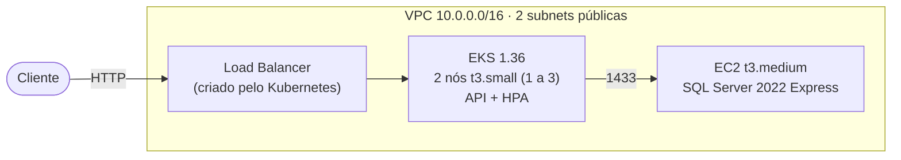

# Infraestrutura (Terraform)

Cria no **AWS Academy Learner Lab** o cluster Kubernetes (EKS) e o banco SQL Server da API, com a
rede necessária para os dois.

## Arquitetura



## O que é criado (14 recursos)

| Arquivo | Recursos | Por quê |
|---|---|---|
| `network.tf` | VPC, 2 subnets públicas (uma por AZ), Internet Gateway e rotas | O EKS exige 2 AZs. Subnets públicas evitam o custo de um NAT; os security groups bloqueiam a entrada vinda da internet. |
| `eks.tf` | Cluster EKS 1.36, node group (t3.small, 1 a 3 nós) e add-on metrics-server | Roda a API; o metrics-server fornece as métricas do HPA. |
| `database.tf` | EC2 com SQL Server em container, security group e senha aleatória | O RDS do lab não oferece SQL Server. O banco só aceita conexões do cluster, na porta 1433. |
| `outputs.tf` | — | Comando do `kubectl` e connection string do banco. |

O lab não deixa criar IAM roles, então tudo usa a `LabRole` e a `LabInstanceProfile` que já existem.
Os parâmetros (região, versão, tamanhos) têm default em `variables.tf`.

## Como usar

Pré-requisitos: Terraform 1.11+, AWS CLI v2 e kubectl. Os comandos rodam em bash (Git Bash no
Windows), a partir de `TC1.RepairShop/infra/`.

1. **Credenciais**: no Learner Lab, *Start Lab* → *AWS Details* → *AWS CLI: Show*, e copie as três
   linhas para `~/.aws/credentials`. Elas expiram a cada sessão (~4 h).
2. **Bucket do state**, uma vez por conta (o lab bloqueia criar buckets pelo Terraform). Se o bucket
   já existir, pule o `create-bucket`:
   ```bash
   BUCKET=tc1-repairshop-tfstate-$(aws sts get-caller-identity --query Account --output text)
   aws s3api create-bucket --bucket "$BUCKET" --region us-east-1
   aws s3api put-bucket-versioning --bucket "$BUCKET" --versioning-configuration Status=Enabled
   ```
3. **Subir** (15 a 20 min). Revise o plano antes do apply: se aparecer `aws_instance.db must be
   replaced`, o banco será apagado.
   ```bash
   terraform init -backend-config="bucket=tc1-repairshop-tfstate-$(aws sts get-caller-identity --query Account --output text)"
   terraform plan -out=tfplan
   terraform apply tfplan
   ```
4. **Acessar o cluster**:
   ```bash
   aws eks update-kubeconfig --region us-east-1 --name tc1-repairshop
   kubectl get nodes
   ```
5. **Destruir ao terminar**. Parar o lab não basta: o EKS continua cobrando.
   ```bash
   kubectl delete -f ../k8s/   # remove primeiro o Load Balancer criado pelo Kubernetes
   terraform plan -destroy -out=tfplan
   terraform apply tfplan
   ```

## Conectando a API ao banco

A connection string, com a senha gerada, sai do output do Terraform e vira um Secret do Kubernetes.
Funciona localmente ou na pipeline, depois do `terraform init`:

```bash
kubectl create secret generic app-db \
  --from-literal=ConnectionStrings__DefaultConnection="$(terraform output -raw db_connection_string)" \
  --dry-run=client -o yaml | kubectl apply -f -
```

No Deployment, leia `ConnectionStrings__DefaultConnection` com `secretKeyRef` (Secret `app-db`). Para
a API ficar acessível de fora, o Service precisa ser `type: LoadBalancer`.

## Pipeline

`.github/workflows/infra.yml`: em PR roda `fmt` e `validate`; `plan`, `apply` e `destroy` são
disparados manualmente (Actions → *Run workflow*). Precisa dos secrets `AWS_ACCESS_KEY_ID`,
`AWS_SECRET_ACCESS_KEY` e `AWS_SESSION_TOKEN`, atualizados a cada sessão do lab.

## Custos

Ligado: ~US$ 0,20/h (~US$ 5/dia). Com o lab parado: ~US$ 2,60/dia, porque o control plane do EKS e
os discos continuam cobrando. O crédito do lab é de US$ 50, então destrua o ambiente quando não
estiver usando.

## Limitações

Escolhas para um ambiente acadêmico com crédito limitado:

- Subnets públicas sem NAT e endpoint do EKS público (com autenticação IAM).
- Banco numa EC2 só: sem alta disponibilidade nem backup automático; a API conecta como `sa`.
- A senha do banco fica no state, que é criptografado no S3 e fica fora do git.
- Sem logs do control plane, VPC Flow Logs nem monitoramento detalhado da EC2, por custo.
- Secrets do Kubernetes com a criptografia padrão do EKS, sem chave KMS própria; sem IRSA (o lab não
  permite criar roles).

O Checkov aponta 9 alertas: 8 vêm dessas escolhas e 1 é falso positivo (ele ainda não conhece a versão 1.36).
